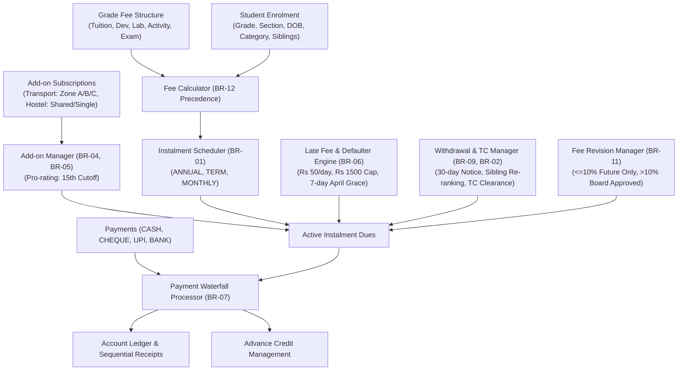

# PS-113 · School Fee Management Engine — System Design Document
**Domain:** Public Services — K-12 School Administration  
**Deliverable:** Week 2 — Core Flows Implementation  
**Language:** Python 3.10+ (Standard Library, zero external dependencies required)

---

## 1. Executive Summary
The **School Fee Management Engine** is an automated, command-file driven engine designed for K-12 school administration. It calculates grade-wise annual fees, applies concessions with strict precedence rules, splits fees into instalment schedules, computes pro-rated add-ons (transport and hostel), tracks late fees with grace periods, enforces payment allocation waterfalls, manages mid-year admissions and withdrawals, handles cheque bounces, and generates demand notices, instalment schedules, student ledgers, and defaulter lists.

---

## 2. System Architecture & High-Level Pipeline

---

## 3. Business Rules Register (BR-01 through BR-12)

### **BR-01: Instalment Plans**
- **ANNUAL:** 1 payment due on 10 April; grants a **3% discount** on post-concession tuition.
- **TERM:** 3 instalments on **10 Apr (40%)**, **10 Aug (30%)**, and **10 Dec (30%)**.
- **MONTHLY:** 10 equal instalments due on the 10th of each month from April to January. The last instalment (January) absorbs any decimal/rounding residue.
- **Plan Modification Policy:** An instalment plan can be changed **only before the first due date** (10 April). Changes attempted on or after 10 April are strictly rejected.

### **BR-02: Sibling Concession & Dynamic Re-ranking**
- Applies to tuition fee only, based on active enrolled siblings in the school:
  - **Eldest child:** Pays full tuition (0% sibling concession).
  - **2nd child:** 10% concession on tuition.
  - **3rd and subsequent children:** 20% concession on tuition.
- Sibling ranking is determined chronologically by Date of Birth (DOB ascending).
- **Dynamic Re-ranking:** If the eldest enrolled sibling withdraws mid-year, remaining active siblings re-rank effective from the **next instalment** (the 2nd child becomes eldest and pays full tuition; the 3rd child becomes 2nd and receives 10%).

### **BR-03: Category Concessions & Additive Stacking with 60% Cap**
- Categories:
  - **STAFF_WARD:** 50% on tuition.
  - **MERIT:** 25% on tuition (previous year marks $\ge 90\%$).
  - **EWS (Economically Weaker Section):** 100% on tuition and 50% on other heads (`development`, `lab`, `activity`, `exam`).
- **Category Precedence:** Only the single highest category concession applies if multiple categories apply.
- **Additive Stacking:** Sibling concession stacks additively with any one category concession.
- **Combined Cap:** The combined tuition concession from stacking is capped at **60% on tuition**.
  - *Example (Edge Case 1):* Staff ward (50%) who is also a 3rd child (20%) has a raw sum of $50\% + 20\% = 70\%$. This is capped at **60%** tuition concession.

### **BR-04: Transport Add-on**
- Route-based monthly rate card:
  - Zone A: Rs 1,800 / month
  - Zone B: Rs 2,400 / month
  - Zone C: Rs 3,000 / month
- Billed with each instalment for the months it covers (e.g. Term 1 covers 4 months, Term 2 covers 3 months, Term 3 covers 3 months).
- **Mid-Month Cutoff:**
  - Joining on or before the **15th of the month**: Bills the **full month** (100%).
  - Joining on or after the **16th of the month**: Bills **half month** (50%).

### **BR-05: Hostel Add-on**
- Monthly room rates (includes mess):
  - Shared: Rs 9,000 / month
  - Single: Rs 12,000 / month
- **Security Deposit:** Exactly 1 month of room rent collected once with the first instalment upon joining. Refunded at withdrawal minus any damages.
- **Non-discountable:** Hostel charges and security deposits are **never discounted** by any category or sibling concessions.

### **BR-06: Late Fees & Defaulters**
- **Rate & Cap:** Rs 50 / day from the day after the due date, capped at a maximum of **Rs 1,500** per instalment.
- **April Grace Period:** A grace period of **7 days** applies to the April instalment only (due 10 April $\rightarrow$ grace ends 17 April). Payments made on or before 17 April incur **Rs 0** late fee.
- **Defaulter Policy:** Students with any unpaid dues overdue beyond **60 days** from the due date are listed as **DEFAULTERS**, and their examination hall tickets are flagged as **WITHHELD**.

### **BR-07: Payment Application Waterfall**
When a payment is received, funds are applied in strict sequential order:
1. **Late fees** of the oldest instalment.
2. **Tuition fee** of that instalment.
3. **Other heads** of that instalment (`development` $\rightarrow$ `lab` $\rightarrow$ `activity` $\rightarrow$ `exam` $\rightarrow$ `admission`).
4. **Add-on fees** of that instalment (`transport` $\rightarrow$ `hostel` $\rightarrow$ `hostel_deposit`).
5. **Next instalment** (repeating steps 1–4).
6. **Advance Credit:** Any unapplied surplus becomes advance credit, automatically drawn down against upcoming future dues.

### **BR-08: Mid-Year Admission**
- Tuition, lab, activity, and exam fees are pro-rated based on remaining academic months (out of 10 months, April–January).
- **15th Cutoff Rule:**
  - Admitted on or before the **15th of the month**: The month counts as a remaining month.
  - Admitted on or after the **16th of the month**: That month does not count; only subsequent months are billed.
- **Development Fee:** The development fee is **never pro-rated** (always 100%).
- **Admission Fee:** A flat, non-pro-rated admission fee of **Rs 10,000** is charged.

### **BR-09: Mid-Year Withdrawal & TC Clearance**
- **Unstarted Terms Tuition Refund:** Tuition is refunded **only for full unstarted terms** if formal withdrawal notice is provided at least **30 days** before the term start date.
- **Other Heads:** All other fee heads are non-refundable.
- **Last Term Exclusion:** A withdrawal occurring in the last term (Term 3) refunds nothing.
- **TC Issuance:** The Transfer Certificate (TC) is issued **only when total outstanding dues are zero**. If any dues remain, TC status is `BLOCKED_DUE_TO_DUES`.
- **Deposit Refund:** Hostel security deposit is refunded at withdrawal minus assessed damages.

### **BR-10: Cheque Bounce**
- A **Rs 500 bounce charge** is debited to the student's ledger.
- The original payment is reversed effective as of the payment date.
- Late fees are **retroactively recomputed** as if the bounced payment was never made.
- If the bounce occurs after the late fee cap duration, late fee reaches the max cap of Rs 1,500 plus the Rs 500 bounce penalty.

### **BR-11: Mid-Year Fee Revision**
- **Revision $\le 10\%$:** Allowed mid-year; applies strictly to instalments **not yet due**. Already due or past instalments remain unchanged.
- **Revision $> 10\%$:** Requires the `BOARD_APPROVED` flag and takes effect **only from the next academic year**.

### **BR-12: Complete Precedence Pipeline**
Every student fee calculation flows through the canonical evaluation pipeline:
$$\text{Category Concession (Highest)} \longrightarrow \text{Sibling Stacking} \longrightarrow \text{Combined Cap (60\%)} \longrightarrow \text{Plan Discount (3\% on ANNUAL)} \longrightarrow \text{Instalment Split} \longrightarrow \text{Add-ons} \longrightarrow \text{Late Fees}$$

---

## 4. Edge Cases Explicitly Verified

| Edge Case | Problem Rule Reference | Implementation & Test Verification |
|---|---|---|
| **1. Staff ward who is also a 3rd sibling** | BR-03, BR-12 | Category (50%) + Sibling (20%) = 70% raw $\rightarrow$ capped at **60%** tuition concession. Verified in `test_edge_cases.py`. |
| **2. Transport joined on the 15th** | BR-04 | Joining on 15 April bills the full month (100% of zone rate). Verified in `test_addons.py`. |
| **3. Payment on 7th day of grace for April** | BR-06 | April due date 10 Apr + 7 days grace = 17 Apr. Payment on 17 Apr incurs **Rs 0** late fee. Verified in `test_late_fees.py`. |
| **4. Eldest sibling withdrawing mid-term** | BR-02, BR-09 | Eldest withdraws during Term 1. In Term 2, 2nd child becomes eldest (0%), 3rd becomes 2nd (10%). Verified in `test_withdrawal.py`. |
| **5. Bounced cheque past late-fee cap** | BR-10, BR-06 | Late fee recomputes to the max Rs 1,500 cap, and Rs 500 bounce fee is charged. Verified in `test_bounce.py`. |
| **6. Mid-year admission on the 16th** | BR-08 | Joining on 16 August excludes August. Only 5 months billed (50% pro-rating). Dev fee 100% + Rs 10,000 admission fee. Verified in `test_midyear_admission.py`. |
| **7. Notice exactly 30 days before term start** | BR-09 | Notice on 2 July for Term 2 starting 1 Aug (30 days) qualifies for full Term 2 tuition refund. Verified in `test_withdrawal.py`. |
| **8. Monthly plan rounding residue in January** | BR-01 | Odd amounts split across 10 instalments: first 9 get equal quotient, 10th (January) absorbs cent residue. Verified in `test_instalments.py`. |

---

## 5. Viva Preparation: Key Explanations

### A. Concession Stacking and Cap Logic
> **Viva Question:** *"How does your engine handle a student who qualifies for multiple concessions, such as a Staff Ward who is also a 3rd sibling?"*
>
> **Answer:**
> 1. First, we evaluate category concessions (`STAFF_WARD` = 50%, `MERIT` = 25%, `EWS` = 100%). By BR-03, only the single highest category applies. For a staff ward, this is 50%.
> 2. Second, we determine the student's sibling rank among active, enrolled siblings based on age/DOB. A 3rd child qualifies for a 20% sibling concession on tuition.
> 3. Third, sibling concessions stack additively with category concessions: $50\% + 20\% = 70\%$.
> 4. Fourth, by BR-03 and BR-12, a hard cap of 60% is enforced on the combined tuition concession. Therefore, the raw 70% is capped at 60%.
> 5. Finally, if the student is on the ANNUAL plan, the 3% annual discount is applied only to the net tuition remaining after this 60% concession. Other heads (development, lab, activity, exam) and add-ons are untouched.

### B. Payment Application Waterfall
> **Viva Question:** *"When a partial or lump-sum payment is recorded, in what exact order is money allocated to dues?"*
>
> **Answer:**
> By BR-07, the payment engine strictly follows a 5-step waterfall across chronologically sorted instalments:
> 1. **Late Fees first:** Clears any accrued late fee on the oldest instalment.
> 2. **Tuition:** Clears tuition due on that instalment.
> 3. **Other Heads:** Clears `development`, `lab`, `activity`, `exam`, and `admission` in consistent head precedence.
> 4. **Add-ons:** Clears `transport`, `hostel`, and `hostel_deposit`.
> 5. **Next Instalment:** Only once all heads of the current instalment are 100% cleared does any remaining money waterfall into the next instalment, starting again at Step 1.
> 6. **Advance Credit:** Any surplus after satisfying all due instalments is stored as `advance_credit`, which is credited on the ledger and automatically drawn down as future instalments mature.

---

## 6. Stretch Goals Implemented
1. **Merit Scholarship Fund Pool (`ScholarshipManager`):**
   - Manages a fixed institutional scholarship fund (e.g. Rs 1,00,000).
   - Ranks all students by academic performance percentage descending.
   - Allocates scholarships to students (with $\ge 85\%$ marks) up to Rs 15,000 each until the pool is exhausted.
2. **Sequential Multi-Campus Payment Receipts (`ReportGenerator`):**
   - Automatically generates unique sequential receipt IDs formatted as `RCP-{campus}-{counter:05d}` (e.g. `RCP-CAMPUS1-00001`).
